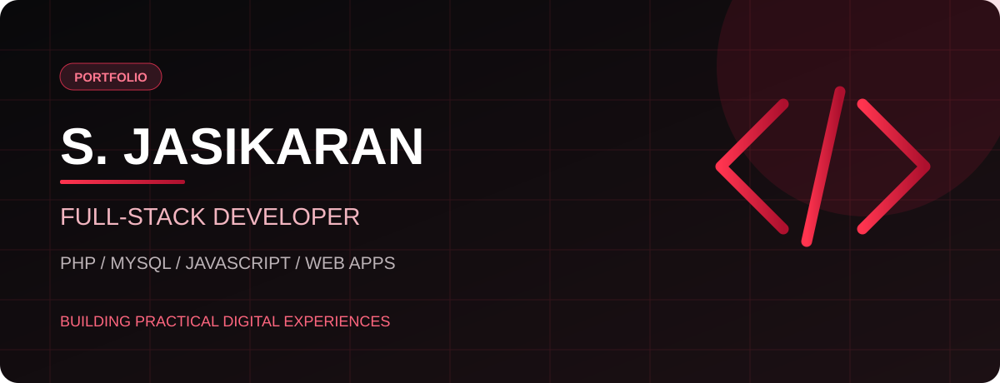
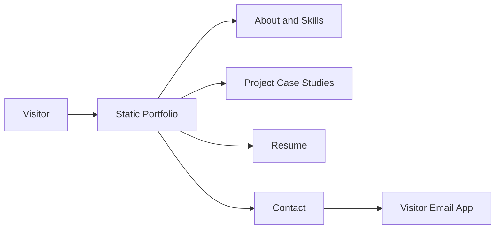

<div align="center">



<br/>

[](https://jasikaran-dev.netlify.app/)
[](https://github.com/jasikaran-dev)
[](https://www.linkedin.com/in/jasi-karan-6892b3286/)

**Personal portfolio · Responsive frontend · Selected software projects**

</div>

---

## ✦ The Project

A personal developer portfolio built to communicate my experience with **full-stack development, business applications, and practical digital products**. It uses a light-first interface with optional dark mode, structured project case studies, and subtle scroll-based motion.

> **Live site:** https://jasikaran-dev.netlify.app/  
> **Repository:** https://github.com/jasikaran-dev/developer-portfolio  
> **Project type:** Static frontend — no application backend or database.

## ✦ Portfolio Experience

| Area | Implementation |
| :--- | :--- |
| **Design system** | Light-first visual language, optional dark theme, responsive bento layouts |
| **Project showcase** | Six case-study pages, project filters, and selected work |
| **Interaction** | IntersectionObserver reveals, reading progress bar, timeline animation |
| **Motion** | Optional GSAP ScrollTrigger effects via CDN, reduced-motion consideration |
| **Contact** | Email-client handoff; **no automatic form submission** |
| **Career** | Resume viewer and download |
| **Discoverability** | SEO metadata, social metadata, Person structured data |
| **Accessibility** | Keyboard focus indicators and reduced-motion support |

## ✦ Technology

<div align="center">


</div>

## ✦ Live Preview

<div align="center">

**[↗ Explore the deployed portfolio](https://jasikaran-dev.netlify.app/)**

<sub>Actual desktop and mobile screenshots will be added after verifying the live pages. The header artwork above is an illustration, not a screenshot.</sub>

</div>

## ✦ How It Works



The site runs in the browser using HTML, CSS, and JavaScript. GSAP-based motion is optional and may load from a CDN. No visitor information is stored in a backend by this repository.

## ✦ Run It Locally

```bash
git clone https://github.com/jasikaran-dev/developer-portfolio.git
cd developer-portfolio
python -m http.server 8000
```

Visit **http://localhost:8000**.

No Node.js installation, npm dependencies, database, or build step is required for the static frontend.

## ✦ Project Structure

```text
developer-portfolio/
├── index.html              # Main portfolio page
├── style.css               # Responsive styles and theme
├── script.js               # Frontend interactions
├── assets/                 # Static assets and README artwork
└── README.md               # Project documentation
```

Additional pages and assets may be present in the repository.

## ✦ Quality & Deployment Checklist

- [x] Public repository with readable source files
- [x] Project documentation and local setup
- [x] Branded README artwork and live-site link
- [x] Documented accessibility and reduced-motion features
- [ ] Capture and add **real** desktop/mobile screenshots
- [ ] Verify deployed website links and all project claims
- [ ] Confirm production canonical URL, Open Graph image, and sitemap
- [ ] Test contact handoff on devices with an email client
- [ ] Run mobile, accessibility, and performance checks

> This README update does **not** alter the hosted website. If the hosting service is linked to the repository, new commits may trigger its configured deployment workflow.

## ✦ Connect

<div align="center">

[](mailto:jasi40094@gmail.com)
[](https://jasikaran-dev.netlify.app/)
[](https://www.linkedin.com/in/jasi-karan-6892b3286/)
[](https://jsnexa.com.lk)

**S. Jasikaran** · Software Engineer & Full-Stack Developer · Sri Lanka

<sub>Crafted with purpose. Built for the web.</sub>

</div>
